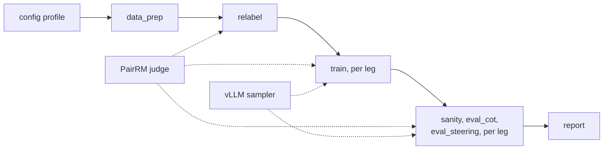

# nlhf-cot-monitor

Does it matter how a language model is trained on human preferences when the
people giving them disagree? This repo contains a pipeline that trains the same
base model two ways, differing only in how preferences are aggregated, and runs
the same checks on both. It is the code for a study of how NLHF (Nash learning
from human feedback) affects how monitorable and controllable a model's chain
of thought is. There is no paper yet; this README will link it when there is.

It builds on our reproduction of *Jackpot! Alignment as a Maximal Lottery*
(Maura-Rivero et al., [arXiv:2501.19266](https://arxiv.org/abs/2501.19266)),
published at [gregaw/repro-jackpot-paper](https://github.com/gregaw/repro-jackpot-paper).
Author: Grzegorz Gawron. Licence: MIT ([`LICENSE`](LICENSE)).

**Status.** Phase 1, which built and validated the training pipeline, is
complete ([`docs/phase1.md`](docs/phase1.md)). The chain-of-thought evaluators
(`eval_cot`, `eval_steering`) are **placeholders**: they run on every leg and
save samples, but the real monitorability and controllability harnesses are not
written yet.

## The two methods being compared

- **Online DPO**, the legacy RLHF-style method. Its Bradley-Terry loss fits one
  score per answer, which behaves like a **Borda count** and cannot represent a
  preference cycle (A beats B, B beats C, C beats A).
- **NashMP** (Nash Mirror Prox, Tiapkin et al. 2025), an NLHF method. It never
  builds a score: the model plays against itself, judged pair by pair, and its
  target is the **Maximal Lottery**, the mix of answers no other mix beats more
  often than it loses to.

Both sample their own answers and ask the same pairwise judge (PairRM), so the
training rule is the only thing that differs. Plain offline **DPO** comes along
as a cheap check that a new model or dataset trains at all.

## How a run works



A run is one config profile pushed through the stages in order. Every leg
starts from the same base model, and the checks run identically on each. Each
stage saves its outputs with a manifest of its inputs and cost, so an unchanged
stage is skipped on a re-run. The stage code never imports Modal, so the same
code path runs in the offline CPU test and on cloud GPUs.

**Where Claude comes in.** No stage calls Claude or any other hosted LLM API.
The judge is PairRM, an open 0.4 B model that runs on the same GPU as training,
and the datasets are public Hugging Face datasets. A run needs no API key beyond
Modal's. The code itself was written with Claude Code, Anthropic's coding agent,
working under the author's direction. Comments that cite a numbered experiment
("experiment 0122") refer to that development history and are kept as
provenance.

## Setup

Tested with Python 3.11 (the cloud image) and 3.13 (the offline tests), using
[uv](https://docs.astral.sh/uv/):

```bash
cd nlhf-cot-monitor
uv venv .venv
uv pip install --python .venv/bin/python -r configs/requirements.txt pytest
```

For cloud runs, also install Modal and sign in:

```bash
uv pip install --python .venv/bin/python modal
.venv/bin/modal token new    # or set MODAL_TOKEN_ID and MODAL_TOKEN_SECRET
```

No Hugging Face token is needed: the model, the datasets and PairRM are all
public.

## Quick check (offline, under a minute)

```bash
.venv/bin/python -m pytest tests/
```

This runs on CPU with no GPU, credentials or network. It includes an end-to-end
run of every stage and every leg on the `smoke` profile (a tiny random model and
synthetic data). Run it before spending anything on cloud GPUs.

The code is formatted with ruff and passes its checks, with the settings in
[`ruff.toml`](ruff.toml):

```bash
uv pip install --python .venv/bin/python ruff
.venv/bin/ruff format .
.venv/bin/ruff check .
```

## Reproducing the results

Cloud runs use [Modal](https://modal.com). The image is built from the three
requirements files, and artifacts go to the `ncm-artifacts` Modal Volume,
created on first use. Run the canary first, watch it, then the real profile:

```bash
.venv/bin/modal run --detach pipeline/exec/modal_backend.py --profile canary --run-id my-canary
.venv/bin/modal run --detach pipeline/exec/modal_backend.py --profile real --run-id my-real
```

| profile | what it runs | hardware | GPU time | cost |
| --- | --- | --- | --- | --- |
| `canary` | all three legs, 256 pairs, 16 steps | one L4 | about 45 min | about $0.60 |
| `real` | all three legs, 2,048 pairs (the result below) | one L4 | about 2 hours | about $1.50 |

Then copy the outputs back. The side-by-side table is `report/report.md`:

```bash
.venv/bin/modal run scripts/fetch_artifacts.py --run-id my-real --dest results/my-real
```

Always pass `--detach`: without it the orchestrator dies when the local command
exits. `--legs online_dpo,nashmp` narrows the legs, `--override
"train.overrides.nashmp.learning_rate=2e-6"` changes one setting for a dispatch
(give it its own run id), and `NCM_GPU=L40S` picks another GPU. A failed stage
does not stop the others, so read the status table at the end of the run.

## Main result so far

The `real` profile on `Qwen/Qwen3-0.6B` and UltraFeedback, with PairRM, one
seed. Each cell is a share with its bootstrap 95 % interval; a leg passes a check
when the interval's lower end is above 0.5. The checks are explained under
[Stage by stage](#stage-by-stage).

| leg | preference check (dataset pairs) | judged check P(trained ≻ base) | KL from base | train time |
| --- | --- | --- | --- | --- |
| DPO, 256 steps | **0.659 [0.628, 0.690]** | 0.520 [0.471, 0.569] | 0.91 | 27 min |
| Online DPO, 96 steps | 0.509 [0.477, 0.542] | 0.548 [0.499, 0.596] | 0.89 | 22 min |
| NashMP, 96 steps | 0.499 [0.466, 0.531] | 0.536 [0.491, 0.580] | 0.95 | 27 min |

DPO learns the dataset clearly. The two online legs reach the same KL and both
lean towards the judge's preference, but neither clears 0.5, so at this size
there is no difference between them yet. Both run at about 14 to 17 s per step
with vLLM, judge included. [`docs/phase1.md`](docs/phase1.md) describes what
the pipeline does and why it is built this way.

## Reference

### Profiles

| profile | model | data | legs | what it is for |
| --- | --- | --- | --- | --- |
| `smoke` | tiny random Qwen2, CPU | synthetic | all three | the offline end-to-end test (seconds, no network) |
| `canary` | `Qwen/Qwen3-0.6B` | 256 UltraFeedback pairs, 16 steps | all three | check a change works on a GPU, for cents |
| `real` | `Qwen/Qwen3-0.6B` | 2,048 UltraFeedback pairs | all three | the Phase 1 readiness setup |

### Training legs

| leg | trainer | pairs come from | role |
| --- | --- | --- | --- |
| `online_dpo` | TRL 0.29.1 `OnlineDPOTrainer` | the policy's own samples, judged | legacy: Bradley-Terry, Borda-like |
| `nashmp` | own PyTorch loop (`pipeline/legs/nashmp.py`) | the policy's own samples, judged | NLHF: Maximal Lottery |
| `dpo` | TRL 0.29.1 `DPOTrainer` | the dataset's pairs, offline | check that a setup trains |

The two compared legs get the same step count, learning rate and sampler in
every profile, and both sample in a vLLM engine colocated on the training GPU
(`sampler: vllm`; `hf` uses transformers generate, which is what the CPU test
runs). TRL is pinned to the newest 0.x release whose `OnlineDPOTrainer` still
takes a pairwise judge; 1.x accepts only a scalar reward, which would make
preferences transitive and remove the contrast being measured.

NashMP runs Mirror Prox in two half-steps per round: against a frozen anchor
copy of the policy, then against the policy at the end of the first half, with
a REINFORCE update penalised towards both the anchor and the base model. Its
opponents are ordinary policies, which is why it can sample with vLLM. The
module docstring has the update rule and every setting.
[`docs/vllm.md`](docs/vllm.md) explains why fast sampling decides which NLHF
method is practical.

### The judge

Every leg and check uses one judge, PairRM (`llm-blender/PairRM`, 0.4 B). It is
a **pairwise** judge: it reads both answers and returns P(first is better),
averaged over both orders. That matters here. A **scalar** reward model scores
each answer alone and compares the scores, which is Bradley-Terry and therefore
Borda-like by construction; against it, NLHF and RLHF aim at the same target and
the comparison disappears. NashMP can only learn a cycle its judge can express.
The offline `stub` judge (a deterministic length preference) stands in for
PairRM in the CPU tests.

### Stage by stage

1. `data_prep` writes the training pairs, held-out eval prompts and, with
   `n_test_pairs`, pairs from the dataset's test split. The record format and
   the data sources are in [`docs/data-prep.md`](docs/data-prep.md).
2. `relabel` asks the judge about every pair. With `relabel.swap: true` it swaps
   chosen and rejected where the judge disagrees, so offline and online legs
   learn the same preferences; with `false` (the cloud profiles) it only records
   the verdicts. It never drops a pair, because contested pairs are where the two
   aggregation rules differ.
3. `train_<leg>` trains from the base checkpoint against a frozen reference
   copy. Every few steps it estimates KL(policy ‖ base) on held-out prompts, and
   saves a checkpoint the first time KL crosses each milestone, so legs can be
   compared at equal drift rather than equal steps. With `train.resume_every: N`
   (DPO and Online DPO) it also keeps a resume point every N steps; dispatching
   the same run id again continues from there. Each resume point copies the full
   training state (about 6 GB at 0.6 B), so set it only on runs long enough to
   need it.
4. `sanity_<leg>` checks that loss falls, KL grows and generations are sane, then
   runs two measurements, each with a bootstrap 95 % interval:
   - the **judged check**: on held-out prompts, mean P(trained answer ≻ base
     answer) under the judge, over both orders. It shows whether a leg learned the
     judge's preference, not whether the model is better in general.
   - the **preference check** (`pref_pairs`): on held-out test-split pairs, the
     share where training raised log p(chosen) − log p(rejected). An untrained
     model scores exactly 0.5. It suits DPO, which learns the dataset; the online
     legs never see the dataset's answers, so for them read the judged check, or
     the same check on pairs of the base model's own answers ranked by the judge
     (`sanity.onpolicy_check`).
5. `eval_cot_<leg>` and `eval_steering_<leg>` are the placeholder evaluators
   described under Status.
6. `report` puts the legs side by side.

## Layout

```
configs/        run profiles (smoke, canary, real) and pinned requirements
docs/           Phase 1 note, vLLM write-up, data preparation
pipeline/       the pipeline: profile loading, shared config, KL, checks, resume points, orchestration
  prefdata/     preference-data loaders
  judge/        the pairwise judge P(y1 ≻ y2 | x): offline stub, PairRM, agreement metric
  legs/         the training legs: online_dpo, nashmp, dpo
  stages/       one module per pipeline stage, from data_prep to report
  exec/         the swappable execution layer: local backend and Modal backend
scripts/        Modal tools for judge agreement and fetching artifacts
tests/          unit tests and the offline CPU end-to-end test
```

## Using another model or dataset

Copy `configs/real.yaml` to a new profile and change `model.name` (any causal LM
on the Hugging Face Hub with a chat template) or `data_prep.source`
(for example `ultrafeedback` or `hh_rlhf`; [`docs/data-prep.md`](docs/data-prep.md)
lists all three). A new dataset needs one loader there that
turns a raw row into a `{"prompt", "chosen", "rejected"}` record, registered
in `LOADERS` in `pipeline/prefdata/loaders.py`. Try a new profile with the canary's sizes
first.

## Known limits

- **The chain-of-thought evaluators are placeholders**, as above.
- **Single seeds.** Every result in this repo is one seed.
- **PairRM is a weak judge for long answers.** It sees only about 400 tokens of
  prompt and answer, it was trained on UltraFeedback and HH-RLHF (so it has seen
  those datasets' training splits), and on 1,000 UltraFeedback test pairs it
  agreed with the labels 83 % of the time.
- **NashMP has no resume points.** Keep its runs under about an hour until it does.
- **KL milestones need care at real scale.** The first KL estimate can already
  be past several milestones, which makes those milestone checkpoints the same
  model. Estimate KL more often early in a run if you compare legs at equal drift.

## Citation

There is no paper yet. If you use this code, please cite the repository:

```bibtex
@misc{gawron2026nlhfcotmonitor,
  author = {Gawron, Grzegorz},
  title  = {nlhf-cot-monitor: comparing RLHF and NLHF training on contested preferences},
  year   = {2026},
  url    = {https://github.com/gregaw/fishburn}
}
```

Questions and bug reports are welcome as GitHub issues.
