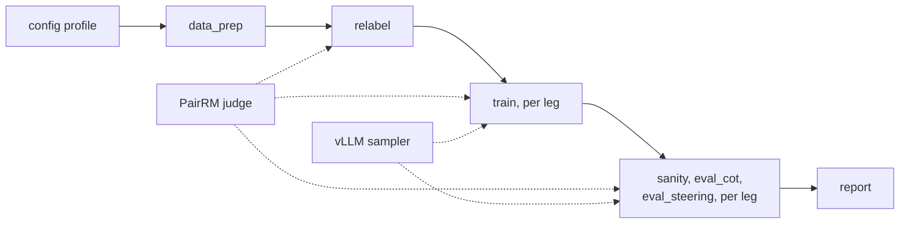

# nlhf-cot-monitor

Does it matter how a language model is trained on human preferences when the
people giving them disagree? This repo contains a pipeline that trains the same
base model two ways, differing only in how preferences are combined, and runs
the same checks on both. It is the code for a study of how NLHF (Nash learning
from human feedback) affects a model's chain of thought: whether it still shows
how the model reached its answer (**monitorability**), and whether the model's
reasoning can still be steered (**controllability**). The two ways should
differ most when preferences conflict; so far the pipeline runs on one judge's
preferences, and contested data comes in a later phase (see Known limits).
There is no paper yet; this README will link it when there is.

It builds on our reproduction of *Jackpot! Alignment as a Maximal Lottery*
(Maura-Rivero et al., [arXiv:2501.19266](https://arxiv.org/abs/2501.19266)),
published at [gregaw/repro-jackpot-paper](https://github.com/gregaw/repro-jackpot-paper).
Author: Grzegorz Gawron. Licence: MIT ([`LICENSE`](LICENSE)).

**Status.** The study lives in [gregaw/fishburn](https://github.com/gregaw/fishburn),
which holds this code in its `code/` folder. Its
[research proposal](https://github.com/gregaw/fishburn/blob/main/Research%20Proposal%20NLHF%20and%20CoT%20monitorability.pdf)
splits the work into three phases: build the training pipeline (Phase 1), then
measure monitorability (Phase 2) and controllability (Phase 3). Phase 1 is
complete; the [Phase 1 report](docs/phase1.md) says what it delivered. The
chain-of-thought evaluators (`eval_cot`, `eval_steering`) are
**placeholders**: they run on every trained model and save samples, but the real
monitorability and controllability harnesses are not written yet.

## The two methods being compared

- **Online DPO**, the standard RLHF-style method. Its Bradley-Terry loss fits
  one score per answer, which ranks answers much as a **Borda count** does (by
  their total wins against all the others), and it cannot represent a
  preference cycle (A beats B, B beats C, C beats A).
- **NashMP** (Nash Mirror Prox, Tiapkin et al. 2025, [arXiv:2505.19731](https://arxiv.org/abs/2505.19731)), an NLHF method. It never
  builds a score: the model plays against itself, judged pair by pair, and its
  target is the **Maximal Lottery**, the mix of answers no other mix beats more
  often than it loses to.

Both sample their own answers and ask the same judge which of two answers is
better. The judge is PairRM, an open 0.4 B model, and it is **pairwise**: it
reads both answers at once. A scalar reward model would score each answer
alone. Comparing such scores is Borda-like by construction, so with a scalar
judge both methods would aim at the same target, and there would be nothing to
compare. That is why the judge must be pairwise.

A third method, plain offline **DPO**, trains on the dataset's own pairs instead
of sampled answers. It is not part of the comparison; it is a cheap check that a
new model or dataset trains at all. Each of the three is a **leg** of a run.

## How a run works



A **profile** is a config file in `configs/` that sets the model, the data, the
legs and their sizes. A run pushes one profile through the **stages** above (run by an
orchestrator, locally or on the cloud), in
order: prepare the data, record the judge's verdict on each pair, train each
leg, check and evaluate each leg, and write a side-by-side report. Every leg
starts from the same **base model**, and the checks run identically on each.
[Stage by stage](#stage-by-stage) has the details.

Each stage saves its outputs with a manifest of its inputs and cost, so an
unchanged stage is skipped on a re-run. The stage code never imports
[Modal](https://modal.com), the cloud GPU service the pipeline runs on, so the
same code path runs in the offline CPU test and on cloud GPUs.

**Where Claude comes in.** No stage calls Claude or any other hosted LLM API.
The judge, PairRM, runs on the same GPU as training, and the datasets are
public Hugging Face datasets. A run needs no API key beyond Modal's. The code
itself was written with Claude Code, Anthropic's coding agent, working under
the author's direction. Comments that cite a numbered experiment ("experiment
0122") refer to that development history and are kept as provenance.

## What we measure

The `sanity_<leg>` stage compares each trained leg with the base model it
started from:

- **KL from base**: how far training moved the model's answers away from the
  base model's, as KL(trained ‖ base) in nats per answer. 0 means unchanged. It
  is estimated every few training steps on held-out prompts, and it measures
  how far a leg moved, not how well it did. Legs can be compared at equal KL, so
  that one is not ahead simply because it moved further.
- **Judge check**: the trained and base models answer the same held-out prompts.
  For each prompt the judge gives P(trained answer is better), once with the
  trained answer first and once with it second, and the two are averaged to
  cancel any preference for a position. The score is the mean over prompts.
- **Dataset check**: held-out pairs from the dataset's test split each have a
  labelled winner (`chosen`) and loser (`rejected`). For each pair, take the
  margin log p(chosen) − log p(rejected), and ask whether training raised it
  above the base model's margin. The score is the share of pairs where it did.
  Only DPO trains on dataset pairs. The online legs can move on this check only
  through the judge, which agrees with the dataset's labels on about 83 % of
  pairs.
- **Own-answers check**: did training move the model towards the answers the
  judge prefers, among answers of the kind the model writes? For each held-out
  prompt, the base model writes two answers, and the judge (asked in both
  orders) names the better one the winner. The margin is log p(winner) −
  log p(loser). The score is the share of answer pairs where the trained
  model's margin is larger than the base model's. If the judge rates both
  answers exactly even, the prompt has no winner and is left out. The check is
  meant for the online legs, which learn from answers the model writes, not
  from the dataset's. It is reported but is not a pass condition.

On the judge, dataset and own-answers checks, **0.5 is the no-effect
value**. A model identical to the base scores exactly 0.5 on the dataset and
own-answers checks (no margin changes, and a tie counts as half), and 0.5 on
average on the judge check. A trained model can change a lot and still score
0.5, if its changes do not favour the preferred answers. Each score comes with a bootstrap
95 % interval (from resampling the prompts or pairs), and a leg passes a check
when the whole interval is above 0.5. The stage also checks that the training
loss falls, that KL grows, and that answers are neither empty nor repetitive.
The report marks whether a leg passed all of these, the own-answers check
excepted; nothing else depends on it.

## Setup

Tested with Python 3.11 (the cloud image) and 3.13 (the offline tests), using
[uv](https://docs.astral.sh/uv/):

```bash
cd nlhf-cot-monitor
uv venv .venv
uv pip install --python .venv/bin/python -r configs/requirements.txt pytest
```

For cloud runs, also install Modal and sign in:

```bash
uv pip install --python .venv/bin/python modal
.venv/bin/modal token new    # or set MODAL_TOKEN_ID and MODAL_TOKEN_SECRET
```

No Hugging Face token is needed: the model, the datasets and PairRM are all
public.

## Quick check (offline, under a minute)

```bash
.venv/bin/python -m pytest tests/
```

This runs on CPU with no GPU, credentials or network. It includes an end-to-end
run of every stage and every leg on the `smoke` profile (a tiny random model and
synthetic data). Run it before spending anything on cloud GPUs.

The code is formatted with ruff and passes its checks, with the settings in
[`ruff.toml`](ruff.toml):

```bash
uv pip install --python .venv/bin/python ruff
.venv/bin/ruff format .
.venv/bin/ruff check .
```

## Reproducing the results

The cloud image is built from `configs/requirements.txt` plus
`requirements-judge.txt` and `requirements-vllm.txt` beside it, and artifacts go
to the `ncm-artifacts` Modal Volume (ncm = nlhf-cot-monitor), created on first
use. Run the `canary` profile first (a short run that checks the setup on a GPU
for well under a dollar), watch it, then the `real` profile:

```bash
.venv/bin/modal run --detach pipeline/exec/modal_backend.py --profile canary --run-id my-canary
.venv/bin/modal run --detach pipeline/exec/modal_backend.py --profile real --run-id my-real
```

| profile | what it runs | hardware | GPU time | cost |
| --- | --- | --- | --- | --- |
| `canary` | all three legs, 256 pairs, 16 steps | one L4 | about 45 min | about $0.60 |
| `real` | all three legs, 2,048 pairs, 96 to 256 steps (the result below) | one L4 | about 2 hours, all stages | about $1.50 |

Then copy the outputs back. The side-by-side table is `report/report.md`:

```bash
.venv/bin/modal run scripts/fetch_artifacts.py --run-id my-real --dest results/my-real
```

Always pass `--detach`: without it the orchestrator dies when the local command
exits. A failed stage does not stop the others, so read the status of each
stage that the run prints at the end. To change a dispatch:

- `--legs online_dpo,nashmp` runs only those legs.
- `--override "train.overrides.nashmp.learning_rate=2e-6"` changes one setting;
  give the run its own run id. To keep the comparison fair, change both
  compared legs the same way.
- the environment variable `NCM_GPU=L40S` picks another GPU.

## Main result so far

The `real` profile on `Qwen/Qwen3-0.6B` and UltraFeedback, with PairRM, one
seed, at the end of training. The checks are defined under
[What we measure](#what-we-measure): 0.5 means no effect, and **bold** marks a
score whose whole interval is above 0.5. The own-answers check uses the base
model's answers and is not a pass condition. KL from base is the final
estimate; it says how far a leg moved, not how well it did. DPO makes one pass
over the 2,048 pairs at 8 per step; the online legs take 96 steps of 8 prompts
each, so they see 768 of the 2,048 prompts, which keeps them under an hour.
Train time is the training stage only.

| leg | dataset check | judge check | own-answers check | KL from base (nats) | train time |
| --- | --- | --- | --- | --- | --- |
| DPO, 256 steps | **0.659 [0.628, 0.690]** | 0.520 [0.471, 0.569] | 0.540 [0.477, 0.603] | 0.91 | 27 min |
| Online DPO, 96 steps | 0.509 [0.477, 0.542] | 0.548 [0.499, 0.596] | 0.489 [0.426, 0.557] | 0.89 | 22 min |
| NashMP, 96 steps | 0.499 [0.466, 0.531] | 0.536 [0.491, 0.580] | 0.536 [0.473, 0.603] | 0.95 | 27 min |

- **DPO, the only leg trained on dataset pairs, learns them clearly.**
- **The online legs lean towards the judge's preference, but not beyond noise.**
  On the judge check, Online DPO and NashMP score 0.548 and 0.536, and neither
  interval is wholly above 0.5. The judge here is the one they trained against,
  so the check shows whether they learned its preference, not whether they got
  better in general.
- **Neither online leg moves on the dataset check or the own-answers check.**
  What they learned from the judge did not carry over to these pairs.
- **Their scores overlap on every check**, at about the same KL, so at this
  scale (0.6 B parameters, 96 steps, one seed) the comparison shows no
  difference between them yet.

## Reference

### Profiles

| profile | model | data | legs | what it is for |
| --- | --- | --- | --- | --- |
| `smoke` | tiny random Qwen2, CPU | synthetic | all three | the offline end-to-end test (seconds, no network) |
| `canary` | `Qwen/Qwen3-0.6B` | 256 UltraFeedback pairs, 16 steps | all three | check a change works on a GPU, cheaply |
| `real` | `Qwen/Qwen3-0.6B` | 2,048 UltraFeedback pairs | all three | the setup of the main result |

### Training legs

| leg | trainer | trains on | role |
| --- | --- | --- | --- |
| `online_dpo` | TRL 0.29.1 `OnlineDPOTrainer` | the policy's own samples for the training prompts, judged | standard: Bradley-Terry, Borda-like |
| `nashmp` | own PyTorch loop ([`pipeline/legs/nashmp.py`](pipeline/legs/nashmp.py)) | the policy's own samples for the training prompts, judged | NLHF: Maximal Lottery |
| `dpo` | TRL 0.29.1 `DPOTrainer` | the dataset's pairs, offline | check that a setup trains |

The two compared legs get the same step count, learning rate and sampler in
every profile. Both sample with a vLLM engine on the training GPU
(`sampler: vllm`); `sampler: hf` uses transformers `generate` instead, which is
what the CPU test runs. [`docs/vllm.md`](docs/vllm.md) explains why fast
sampling decided which NLHF method the pipeline uses.

TRL is pinned to the newest 0.x release whose `OnlineDPOTrainer` still takes a
pairwise judge. TRL 1.x accepts only a scalar reward, which would remove the
contrast being measured.

NashMP's module docstring has its update rule and every setting.

### The judge

PairRM (`llm-blender/PairRM`, 0.4 B) reads a prompt x and two answers y1 and
y2 and gives P(y1 ≻ y2 | x), the probability that y1 is better. The pipeline
asks it in both orders and averages P(y1 ≻ y2) with 1 − P(y2 ≻ y1), which
cancels any preference for a position. Every leg and
check uses it. The offline `stub` judge (a deterministic preference for longer
answers) stands in for it in the CPU tests.

### Stage by stage

1. `data_prep` writes the training pairs, held-out eval prompts and, with
   `n_test_pairs`, pairs from the dataset's test split for the dataset check.
   The record format and the data sources are in [`docs/data-prep.md`](docs/data-prep.md).
2. `relabel` asks the judge about every pair and records its verdict. With
   `relabel.swap: true` it also swaps chosen and rejected where the judge
   disagrees; the cloud profiles keep the dataset's labels. The labels matter
   only to DPO: the online legs use only the pairs' prompts.
3. `train_<leg>` trains from the base model. It estimates KL from base every few
   steps, and saves a checkpoint the first time KL crosses each milestone in
   `shared.kl.milestones`, so legs can be compared at equal KL.
   - With `train.resume_every: N` (DPO and Online DPO), it also saves a resume
     point every N steps, and dispatching the same run id again continues from
     there. Each resume point copies about 6 GB at 0.6 B, so use it only on long
     runs.
4. `sanity_<leg>` runs the checks under [What we measure](#what-we-measure).
   The dataset check uses the first `sanity.pref_pairs` of `data_prep`'s
   `n_test_pairs`, and `sanity.onpolicy_check` turns on the own-answers check.
5. `eval_cot_<leg>` and `eval_steering_<leg>` are the placeholder evaluators
   described under Status.
6. `report` puts the legs side by side.

## Layout

```
configs/        run profiles (smoke, canary, real) and pinned requirements
docs/           Phase 1 report, vLLM write-up, data preparation
pipeline/       the pipeline: profile loading, shared config, KL, checks, resume points, orchestration
  prefdata/     preference-data loaders
  judge/        the pairwise judge: offline stub, PairRM, and its agreement with dataset labels
  legs/         the training legs: online_dpo, nashmp, dpo
  stages/       one module per pipeline stage, from data_prep to report
  exec/         the swappable execution layer: local backend and Modal backend
scripts/        Modal tools for judge agreement and fetching artifacts
tests/          unit tests and the offline CPU end-to-end test
```

## Using another model or dataset

Copy `configs/real.yaml` to a new profile and change `model.name` (any causal LM
on the Hugging Face Hub with a chat template) or `data_prep.source`
(`synthetic`, `ultrafeedback` or `hh_rlhf`; [`docs/data-prep.md`](docs/data-prep.md)
describes each). A new dataset needs one loader that turns a raw row into a
`{"prompt", "chosen", "rejected"}` record, registered in `LOADERS` in
`pipeline/prefdata/loaders.py`. Try a new profile with the canary's sizes first.

## Known limits

- **The chain-of-thought evaluators are placeholders**, as above.
- **No chain of thought is trained yet.** Phase 1 runs Qwen3 with its thinking
  mode off and answers capped at 192 tokens, so the trained models do not yet
  produce the chains of thought the study is about.
- **No contested preferences yet.** All results use one judge on UltraFeedback,
  and how often PairRM's verdicts form cycles on this data has not been
  measured. "No difference yet" may partly mean there was little for the two
  methods to differ on.
- **Single seeds.** Every result in this repo is one seed.
- **PairRM is a weak judge for long answers.** It sees only about 400 tokens of
  prompt and answer, and it was trained on UltraFeedback and HH-RLHF, so it has
  seen those datasets' training splits.
- **NashMP has no resume points.** Keep its runs under about an hour until it does.
- **KL milestones need care at real scale.** The first KL estimate can already
  be past several milestones, which makes those milestone checkpoints the same
  model. Estimate KL more often early in a run if you compare legs at equal KL.

## Citation

There is no paper yet. If you use this code, please cite the repository:

```bibtex
@misc{gawron2026nlhfcotmonitor,
  author = {Gawron, Grzegorz},
  title  = {nlhf-cot-monitor: comparing RLHF and NLHF training on contested preferences},
  year   = {2026},
  url    = {https://github.com/gregaw/fishburn}
}
```

Questions and bug reports are welcome as GitHub issues.
